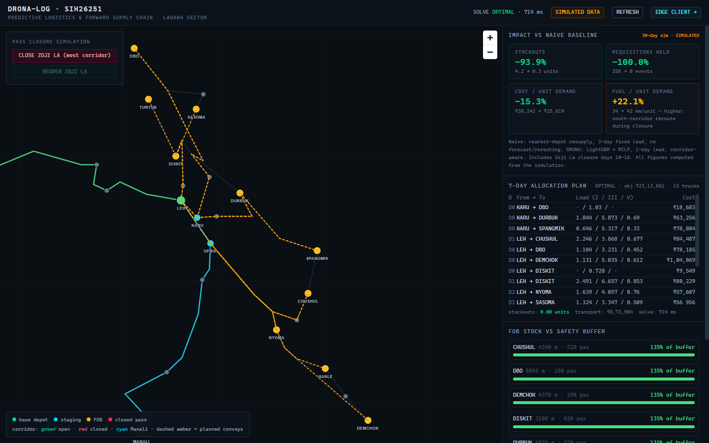
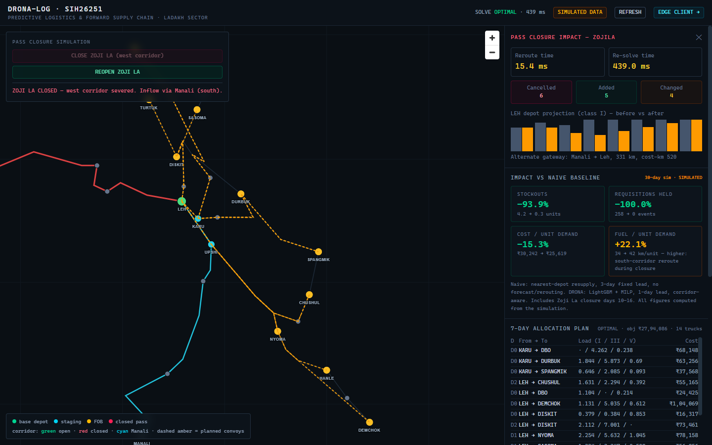
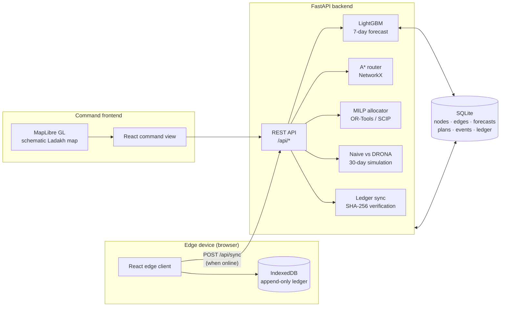

# DRONA-LOG

**Predictive logistics and forward supply chain for high-altitude military formations.**

SIH problem statement **SIH26251** · Ladakh sector prototype

[](backend)
[](backend)
[](backend/app/allocator.py)
[](backend/app/forecast.py)
[](frontend)
[](frontend/src/components/TacticalMap.jsx)
[](docker-compose.yml)

DRONA-LOG is a working end-to-end prototype that forecasts demand at forward
operating bases, routes supplies over an elevation-penalised mountain road
network, allocates them with a mixed-integer optimiser, replans automatically
when a strategic pass closes, and keeps requisitions working when the backend is
offline through a tamper-evident edge ledger.



> **All data is synthetic.** Every operational number is labelled `SIMULATED`
> and is computed at runtime from a seeded 30-day simulation. Nothing is
> hardcoded — including the trade-offs that do not flatter the system.

---

## The problem

Forward posts in Ladakh depend on a small number of high-altitude corridors.
Zoji La can close for days, weather and gradient make routes expensive, demand
is seasonal and troop-driven, and connectivity at the edge is unreliable.
A conventional spreadsheet-and-experience process reacts late, hoards inventory
at depots, and holds requisitions when a corridor shuts.

DRONA-LOG closes that loop:

| Capability | Implementation |
|---|---|
| Anticipate demand | LightGBM per supply class, 7-day horizon, weather + troop features |
| Choose realistic routes | A* with a gradient penalty; closed passes removed from the graph |
| Allocate scarce capacity | OR-Tools MILP on SCIP: trucks, loads, depot stock, safety buffers, corridor inflow |
| React to a closure | Reroute + re-solve + before/after convoy diff + measured solve time |
| Operate at the edge | React client, IndexedDB, append-only SHA-256 hash chain, offline requisitions |
| Reconcile safely | Server recomputes every hash and rejects tampered, replayed or broken chains |
| Measure honestly | Naive baseline vs DRONA-LOG on the same 30-day seeded scenario |

---

## Quick start

```bash
docker compose up --build
```

Open:

| URL | Screen |
|---|---|
| http://localhost:8080 | Command view — map, allocation plan, metrics, closure simulation |
| http://localhost:8080/edge | Edge client — offline requisitions and sync |
| http://localhost:8000/docs | FastAPI / OpenAPI documentation |

First boot seeds the database with 49 nodes, 53 road edges, 12 months of daily
consumption history and 10 FOBs, then trains three LightGBM models. Allow about
30 seconds; the frontend waits for the backend healthcheck.

The seed is deterministic (seed `26251`), so restarts reproduce the same
scenario. To return to a clean demonstration state:

```bash
docker compose down -v && docker compose up -d
```

No runtime API keys, tile servers, CDNs or external data services are required.

---

## 2-minute demo

**0:00 — Command view** ([screenshot](docs/command-view.png))

- Dark tactical map of Ladakh with 1 base depot (Leh), 2 staging depots
  (Karu, Upshi), 10 FOBs and 12 named passes.
- Green = open Zoji La (west) corridor, cyan = Manali (south) corridor,
  amber dashed = planned convoys.
- Right panel: 7-day MILP plan, FOB stock vs safety buffer, and 30-day
  **SIMULATED** impact versus a naive resupply policy.
- Solved plan on the seeded run: **OPTIMAL**, zero stockouts, 15 truck
  dispatches, ₹23.1 L objective, solve time displayed live in milliseconds.

**0:30 — Close Zoji La**

- Press **CLOSE ZOJI LA — WEST CORRIDOR**.
- The west corridor turns red, the router selects the Manali → Leh alternate,
  and the MILP re-solves against closed-pass routes and reduced south-corridor
  inflow capacity.
- The panel shows both timings (example run: **15.4 ms** reroute,
  **439 ms** re-solve), the convoy diff (**6 cancelled / 5 added / 4 changed**
  in that run), and the resulting depot inventory projection.



- Press **REOPEN ZOJI LA** to restore the west corridor.

**1:10 — Read the honest metrics**

The comparison uses the identical seeded demand, weather, troop surge and
scripted 7-day closure:

| Metric (30-day simulation) | Naive policy | DRONA-LOG | Change |
|---|---:|---:|---:|
| Stockout units | 4.15 | 0.25 | **−93.9%** |
| Requisitions held | 258 | 0 | **−100%** |
| Cost per unit demand | ₹30,242 | ₹25,619 | **−15.3%** |
| Fuel per unit demand (km) | 34.46 | 42.06 | **+22.1%** |
| Below-buffer unit-days | 983.9 | 493.3 | **−49.9%** |

The last row is deliberately not hidden: during the closure DRONA-LOG keeps
delivering through the longer southern corridor, which costs fuel. The point is
availability with an explicit trade-off, not a slide with invented savings.
Every figure is recomputed from the simulation at runtime and labelled
`SIMULATED`.

**1:40 — Offline edge client** ([tamper evidence](docs/edge-tamper.png))

1. Open http://localhost:8080/edge and record two or three requisitions.
2. Stop the backend: `docker compose stop backend`.
3. The status flips to **BACKEND OFFLINE**; requisitions still record locally
   in IndexedDB with a hash-chained ledger.
4. Restart: `docker compose start backend`. Wait for **BACKEND ONLINE**, press
   **SYNC** — all pending entries are accepted and server stock is updated.
5. Press **SIMULATE HAND-EDIT OF LAST ENTRY**, then **SYNC** again. The entry's
   quantity is changed without re-hashing, so the server rejects it:
   **0 accepted · 1 rejected — HASH MISMATCH**. Entries already accepted on the
   server stay valid, while the local chain is flagged broken.
6. Use **CLEAR LOCAL LEDGER** to reset the demo.

**2:00 — Audit trail**

`GET /api/events` returns every closure/reopen with router time, solve time and
the plan diff. `GET /api/ledger` returns the server-side hash chain grouped by
device.

---

## Acceptance criteria and evidence

| Criterion | Implementation | Verified evidence |
|---|---|---|
| Feasible baseline plan with zero stockouts | MILP with soft stockout/buffer penalties, 7-day horizon, capacity and fleet constraints | `test_baseline_plan_feasible_zero_stockouts`, `test_plan_zero_stockouts`; seeded run: `OPTIMAL`, 0 stockout units, 15 deliveries |
| Closure produces a valid alternate and a new plan | Closed pass removed from graph, A* remaps every depot→FOB route, MILP re-solves, diff and timings returned | `test_zojila_closure_severs_west_corridor`, `test_pass_closure_flow`; west route `None`, south route valid and avoids ZOJILA; new plan has higher cost |
| Solve time displayed | Wall-clock solve time stored in every plan and closure event | Returned as `solve_time_ms` / `re_solve` and rendered in the closure panel (example **439 ms**) |
| Offline entries sync after restart | IndexedDB append-only ledger, server idempotent sync, stock applied on acceptance | Live demo: 2 entries recorded with backend stopped, 2 accepted after restart; `test_sync_after_backend_restart` |
| Hand-edited entry is rejected | Server recomputes SHA-256 over canonical fields; verifies sequence and previous link | `test_tampered_entry_rejected`, `test_tampered_payload_rejected`, `test_tampered_replay_rejected`; production UI: **0 accepted · 1 rejected** |
| One-command bring-up | Docker Compose: backend healthcheck, nginx SPA + `/api` proxy, persistent SQLite volume | Stack verified healthy from `http://localhost:8080/api/health` and `http://localhost:8000/api/health` |
| Metrics are computed, not hardcoded | Naive policy and DRONA policy simulated on the same seed; all cards labelled SIMULATED | `test_metrics_computed_not_hardcoded`, `test_drona_beats_naive_on_stockouts_and_holds`; live values match raw simulation counters |
| README with run steps and demo | This document | `docker compose up --build`, local fallback, 2-minute script, API reference |

Test suites:

```bash
cd backend  && python -m pytest tests/ -q    # 24 passed
cd frontend && npx vitest run                # 6 passed (JS/Python hash parity)
cd frontend && npm run build                 # production bundle
```

The 24 backend tests cover the API surface, forecast shape, baseline planning,
gradient-aware routing, closure reachability scenarios, metrics consistency,
offline/restart sync, idempotent replay, tampered entries, broken previous-hash
links and sequence gaps.

---

## Architecture



### Demand forecast

- Three models (classes **I** rations, **III** POL, **V** ammunition), trained
  locally on 365 days of synthetic history.
- Features: daily mean temperature, snowfall, troop strength and day of week.
- LightGBM regression with 300 trees; 7-day operational horizon.
- Forecast output drives the MILP demand vector.

### Routing

- Graph from the synthetic Ladakh network; edge geometry is interpolated.
- A* cost is `distance_km + 6 × gradient_percent`. A climb therefore costs more
  than its map distance, and the returned route reports the gradient penalty.
- Pass nodes are removed for closures. Zojila closure removes the west gateway
  path and forces the Manali route; Khardung La closure routes Nubra traffic via
  Wari La.
- Route matrix is computed for each depot→FOB pair and fed to the MILP.

### Allocation MILP

Integer truck and continuous load decisions over a 7-day horizon. The objective
minimises:

- transport: `cost-km × units × ₹42/unit-km`,
- fixed dispatch cost: ₹4,000 per truck,
- procurement: ₹18,000/unit via west, ₹24,000/unit via south,
- stockout penalty: ₹500,000 per unmet unit,
- safety-buffer deficit: ₹60,000 per unit-day,
- a small day-escalation term to break procurement symmetry.

Constraints include 10 units per truck, per-depot daily fleet limits, one-day
delivery lead, FOB and depot stock balance, safety buffers, war-reserve depot
levels, and closure-aware gateway inflow caps (south has materially less
capacity than west). SCIP runs with a 1% gap and 10-second limit; wall time is
reported to the UI.

### Pass-closure flow

`POST /api/events/pass-closure` persists the closure, rebuilds the graph,
remaps route costs, re-solves the MILP, diffs the old and new delivery plans,
records affected FOB routes and stores the event with both timings. The UI
animates the corridor state from the same API payload, so the map, plan, diff
and inventory chart never disagree.

### Honest baseline simulation

`simulate.py` runs two policies against the same seeded 30-day demand:

- **Naive:** nearest-depot resupply, fixed 3-day lead, trailing-mean demand,
  no forecast and no rerouting; convoys are held when Zoji La is shut.
- **DRONA:** LightGBM demand, MILP dispatch, one-day lead, corridor-aware
  replanning on closure days.

The resulting counters feed the metric cards. Fuel per unit is worse for DRONA
because availability is maintained via the south corridor during the closure;
the UI presents that as a warning, not a success.

### Edge ledger

Each device maintains an append-only ledger in IndexedDB:

```text
hash = SHA-256(seq | prev_hash | payload_json | fob_id | class_id | entry_type | qty)
genesis: prev_hash = "0" × 64
```

The browser uses WebCrypto; the server uses Python `hashlib`. A unit test
asserts byte-identical digests across both implementations. On sync, FastAPI:

1. verifies entry shape and quantity bounds,
2. recomputes the hash from canonical fields,
3. enforces `seq = previous + 1` and the stored previous hash,
4. idempotently accepts true duplicates,
5. re-verifies an already-synced entry before reporting it as a duplicate,
6. rejects tampering, replays with altered content, gaps and broken links,
7. advances accepted replenishment entries into server stock.

---

## Synthetic data

| Entity | Count / detail |
|---|---|
| Nodes | 49 (2 gateways, 22 transit, 12 passes, 2 staging, 1 base depot, 10 FOBs) |
| Road edges | 53, with distance, simulated gradient and geometry |
| Passes | Zoji La, Namika La, Fotu La, Rohtang, Baralacha, Tanglang La, Khardung La, Wari La, Saser La, Chang La, Kaksang La, Umling La |
| Supply classes | I — rations/fresh; III — POL; V — ammunition |
| FOBs | DBO, Turtuk, Sasoma, Diskit, Durbuk, Spangmik, Chushul, Nyoma, Hanle, Demchok |
| History | 365 days per FOB driven by temperature, snowfall, troops, exercise surge |
| Stock | Per-FOB initial stock and 7-day safety buffer; depot war reserve |

FOB coordinates, elevations and road topology are a simplified synthetic model
for demonstration, not an authoritative operational map.

---

## API reference

| Method | Endpoint | Purpose |
|---|---|---|
| GET | `/api/health` | Seed/models/metrics readiness |
| GET | `/api/network` | Nodes, edges, stock, gateway routes, corridor state |
| GET | `/api/fobs` | FOB list with stock and demand context |
| GET | `/api/forecast?days=7` | Per-FOB, per-class LightGBM forecast |
| GET | `/api/plan` | Latest 7-day MILP plan (solves on first request) |
| POST | `/api/plan/recompute` | Force a fresh MILP solve |
| POST | `/api/events/pass-closure` | `{ "pass_id": "ZOJILA", "action": "closed" \| "reopened", "days": 7 }` → reroute, re-solve, diff, timings |
| GET | `/api/events` | Closure/reopen audit log |
| GET | `/api/metrics` | SIMULATED naive-vs-DRONA comparison |
| POST | `/api/metrics/recompute` | Recompute the 30-day comparison |
| POST | `/api/sync` | Verify and ingest edge ledger entries |
| GET | `/api/ledger` | Server ledger chains by device |

Interactive schemas are available at `http://localhost:8000/docs`.

---

## Project structure

```text
.
├── backend/
│   ├── app/
│   │   ├── seed.py        synthetic theatre, weather, demand, road graph
│   │   ├── graph.py       NetworkX graph builder (closure-aware)
│   │   ├── router.py      elevation-penalised A* and route matrix
│   │   ├── forecast.py    LightGBM models and forecast payload
│   │   ├── allocator.py   OR-Tools / SCIP MILP
│   │   ├── scenario.py    assembles solve inputs for a closure state
│   │   ├── simulate.py    naive vs DRONA 30-day evaluation
│   │   ├── main.py        FastAPI endpoints and sync verification
│   │   └── config.py      network, fleet, cost and solver parameters
│   ├── tests/             acceptance and invariant tests
│   ├── requirements.txt
│   └── Dockerfile
├── frontend/
│   ├── src/
│   │   ├── views/CommandView.jsx    map, plan, metrics, closure flow
│   │   ├── views/EdgeClient.jsx     offline requisitions and sync
│   │   ├── components/TacticalMap.jsx
│   │   └── edge/ledger.js           hash-chained IndexedDB ledger
│   ├── nginx.conf         SPA fallback and /api proxy
│   ├── vite.config.js
│   └── Dockerfile
├── docs/                  verified UI screenshots
├── docker-compose.yml
└── README.md
```

---

## Run without Docker

### Backend

```bash
cd backend
python -m venv .venv
# Windows: .venv\Scripts\activate    ·    macOS/Linux: source .venv/bin/activate
pip install -r requirements.txt
python -m app.seed --force
python -m uvicorn app.main:app --port 8000
```

### Frontend

```bash
cd frontend
npm install
npm run dev          # http://localhost:5173, proxies /api to :8000
```

Production build: `npm run build` (nginx serves the generated `dist/` in the
container image).

---

## Limitations and next steps

- This is a prototype on **synthetic** data; it is not connected to service
  records, satellite weather or live road reports.
- The edge ledger is per-device with a fixed genesis. Production would register
  device keys, sign entries and use a durable replication log.
- Sync applies accepted requisitions to stock but deliberately does not attempt
  distributed conflict resolution between devices.
- Route geometry is schematic, not survey-grade; map tiles are intentionally
  local so the demo works without internet.
- SCIP is time-limited with a 1% gap, so solve times and the final decimal of
  the objective can vary slightly across machines. Operational figures are
  recomputed, not baked into the UI.
- Authentication/roles and classified-data handling are out of scope for this
  prototype.

---

Built as a working submission for **Smart India Hackathon problem statement
SIH26251** — predictive logistics for the Indian Army in the Ladakh sector.
