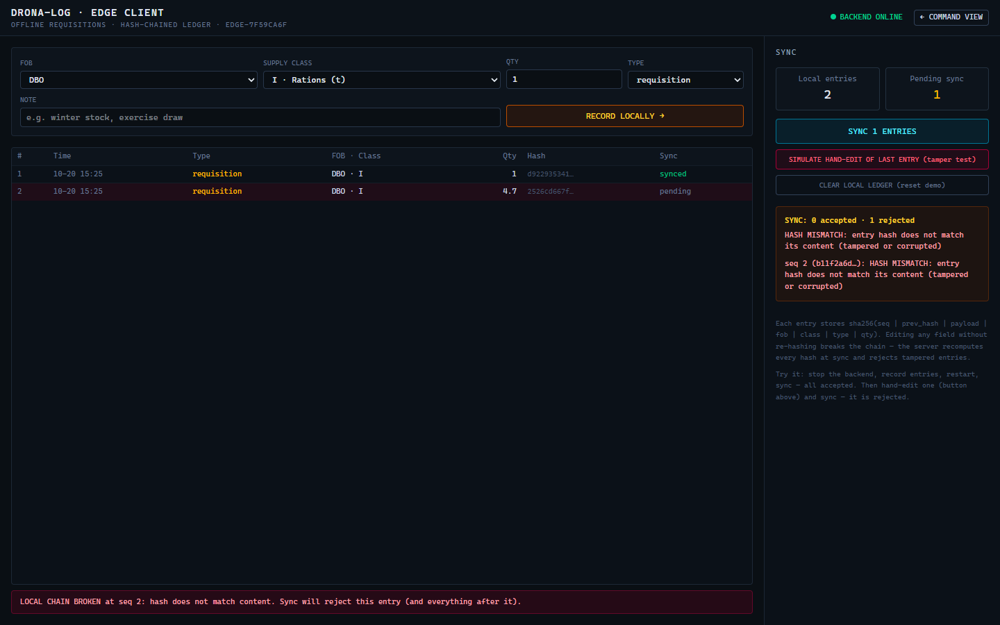
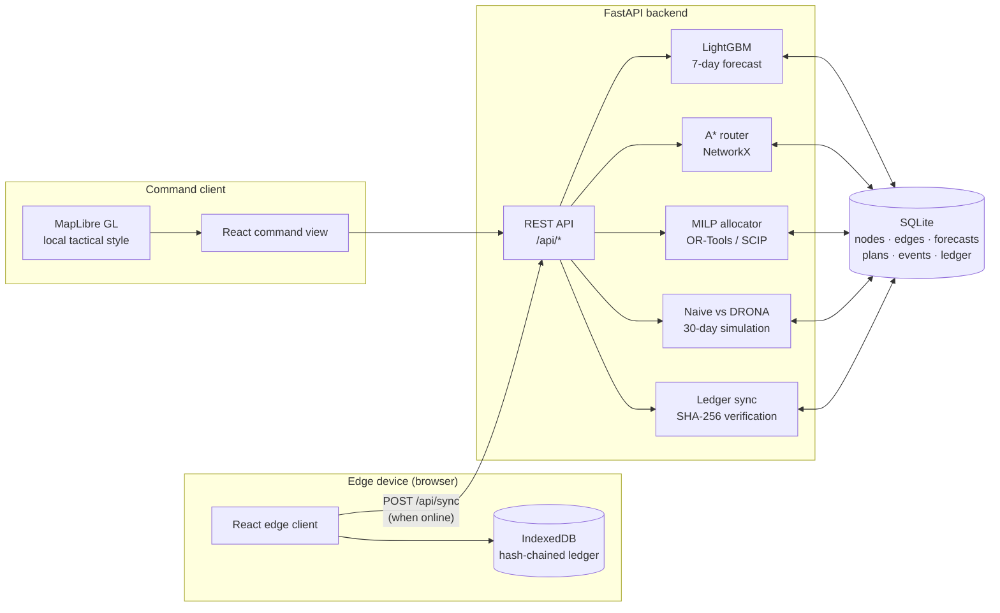

# DRONA-LOG

**Predictive logistics and terrain-aware resupply for high-altitude military formations.**

SIH 2026 · Problem Statement **SIH26251** · Team **Subterra Mesh (185972)**

[](backend)
[](backend)
[](backend/app/allocator.py)
[](backend/app/forecast.py)
[](frontend)
[](frontend/src/components/TacticalMap.jsx)
[](docker-compose.yml)

DRONA-LOG is a working end-to-end prototype for forward-area supply chains. It
forecasts demand at forward operating bases, routes supplies over an
elevation-penalised mountain network, allocates limited transport with a
mixed-integer optimiser, automatically re-plans when a strategic pass closes,
and keeps field requisitions working when the backend is unreachable.


> **All operational data is synthetic.** Every scenario figure is recomputed
> from a deterministic 30-day simulation and labelled `SIMULATED`. The
> trade-offs that do not flatter the system are shown as well.

---

## Overview

Forward posts in Ladakh depend on a small number of high-altitude corridors.
Zoji La can close for days, weather and gradient make routes expensive, demand
is seasonal and troop-driven, and connectivity at the edge is unreliable. A
static spreadsheet plan reacts late, hoards stock at depots and holds
requisitions when a corridor shuts.

DRONA-LOG closes that loop in one system:

| Capability | Implementation |
|---|---|
| Anticipate demand | LightGBM per supply class, 7-day horizon, weather and troop features |
| Choose realistic routes | A* with a gradient penalty; closed passes are removed from the graph |
| Allocate scarce capacity | OR-Tools MILP on SCIP: fleet, loads, depot stock, buffers, corridor inflow |
| React to a closure | Reroute, re-solve, return a convoy diff and measured solve time |
| Operate at the edge | React edge client, IndexedDB, SHA-256 hash-chained local ledger |
| Reconcile safely | Server recomputes hashes, rejects tampering, gaps and broken links |
| Measure honestly | Naive policy vs DRONA on the same seeded 30-day scenario |

The prototype is decision support, not an autonomous command system: every plan
is visible to an operator, and a closure is a human-triggered event that can be
reopened.

---

## Prototype results

The 30-day comparison uses identical synthetic demand, weather, troop surge and
a scripted Zoji La closure on days 10–16. All figures are generated at runtime
by `backend/app/simulate.py` and labelled `SIMULATED`.

| Metric (30 days) | Naive policy | DRONA-LOG | Change |
|---|---:|---:|---:|
| Stockout units | 4.15 | 0.25 | **−93.9%** |
| Below-buffer unit-days | 983.9 | 493.3 | **−49.9%** |
| Cost per unit demand | ₹30,242 | ₹25,619 | **−15.3%** |
| Trucks dispatched | 207 | 160 | **−22.7%** |
| Truck-km per unit demand | 34.46 | 42.06 | **+22.1%** |
| Convoy holds | 258 | 0 | see note |

**Note on the last two rows.** Truck-km per unit is a fuel proxy, and it rises
because the system keeps delivering through the longer southern corridor while
Zoji La is shut. That is an explicit availability-versus-fuel trade-off, not a
saving. The naive policy enters a hold state when the west corridor closes;
DRONA re-plans through the alternate corridor, so its hold counter is zero by
design rather than a measured reduction in an equivalent queue.

The prototype does **not** claim fuel savings. It claims better availability,
lower cost per unit and fewer buffer violations, with the fuel penalty exposed.

---

## Screens

### Command view

The map-first operating screen shows the Ladakh network, corridor state, planned
convoys, the 7-day allocation plan, FOB stock against safety buffers, closure
timings and the simulated impact cards.


### Closure workflow

Closing Zoji La removes the west gateway from the route graph, selects the
Manali corridor, re-solves the MILP and returns the before/after convoy diff.


### Edge client

Field requisitions are stored in IndexedDB with a hash-chained ledger. The
client keeps working when the backend stops; on reconnection it syncs the chain
and rejects a hand-edited entry.



The app has two operator views (`/` and `/edge`) plus interactive FastAPI
documentation at `/docs`. Map tiles and assets are local, so the demo does not
depend on a CDN or tile server.

---

## Quick start

```bash
docker compose up --build
```

| URL | Purpose |
|---|---|
| http://localhost:8080 | Command view |
| http://localhost:8080/edge | Offline edge client |
| http://localhost:8000/docs | FastAPI / OpenAPI documentation |

First boot seeds 49 nodes, 53 road edges and 10 FOBs, generates 365 days of
synthetic history and trains three LightGBM models. Allow about 30 seconds; the
frontend waits for the backend healthcheck. The seed is deterministic
(`26251`), so restarts reproduce the same scenario.

To reset the demonstration:

```bash
docker compose down -v && docker compose up -d
```

No API keys, external data services or tile servers are required at runtime.

---

## 2-minute demo

[Watch the 2:33 narrated walkthrough](docs/drona-log-demo.mp4) — command view,
Zoji La closure and Manali reroute, offline requisition sync, and a rejected
hash-chain tamper. The MP4 is stored in `docs/`; no script is required to run
the prototype.

---

## Architecture



### Demand forecast

Three LightGBM regressors (Class I rations, Class III POL, Class V ammunition)
are trained locally on 365 days of seeded history. Features are daily mean
temperature, snowfall, troop strength and day of week. Each model uses 300
trees, a 0.05 learning rate, 31 leaves and a fixed random state. The 7-day
forecast becomes the demand vector for the allocator.

### Routing

The road graph is drawn from a simplified Ladakh network. Edge distance is
`1.25 × haversine`, with a 3 km minimum; gradient is derived from endpoint
elevation. A* minimises:

```text
edge cost = distance_km + 6.0 × gradient_percent
```

A closure deletes the pass node and all incident edges. The west corridor is
severed by Zoji La, Namika La or Fotu La; the south corridor by Rohtang,
Baralacha or Tanglang La. Khardung La closure routes Nubra traffic through the
alternate Wari La path. The router also returns the distance, gradient penalty,
maximum elevation and legs used by the UI.

### Allocation MILP

Integer truck dispatches and continuous loads are solved over a 7-day horizon.
The objective minimises transport cost, fixed dispatch cost, procurement cost,
stockout penalty, safety-buffer deficit and a small day-escalation term:

| Term | Value used in the prototype |
|---|---:|
| Transport | ₹42 × distance_km × units |
| Dispatch | ₹4,000 per truck |
| Procurement | ₹18,000/unit west; ₹24,000/unit south |
| Stockout | ₹500,000 per unmet unit |
| Buffer deficit | ₹60,000 per unit-day |
| Solver | SCIP, 10 s limit, 1% gap, 1 thread |

Constraints cover truck capacity (10 units), daily fleet limits, one-day
delivery lead, FOB and depot stock balance, safety buffers, war reserves and
corridor inflow caps. The south corridor has materially less inflow capacity
than the west.

### Pass-closure flow

`POST /api/events/pass-closure` persists the event, rebuilds the graph, remaps
the depot-to-FOB route matrix, re-solves the MILP, diffs the old and new plans,
and stores router/solve timings. The UI reads the same event payload, so map,
plan, diff and inventory never disagree.

A recorded sample closure measured **28.5 ms** for rerouting and **688.5 ms**
for the MILP re-solve; an earlier run measured 15.4 ms and 439 ms. Timings vary
with machine and solver state. The plan diff for the recorded event was
6 cancelled, 5 added and 4 changed convoys.

### Offline edge ledger

Each browser device keeps a local ledger in IndexedDB. Entries are chained:

```text
hash = SHA-256(seq | prev_hash | payload_json | fob_id | class_id | entry_type | qty)
genesis prev_hash = "0" × 64
```

The browser uses WebCrypto and the server uses Python `hashlib`; a frontend test
asserts byte-identical digests. On sync, FastAPI verifies the entry shape,
recomputes the hash from canonical fields, enforces sequence and previous-hash
links, accepts true duplicates idempotently, and rejects tampering, replayed
changes, sequence gaps and broken links. Only accepted `receipt` entries update
server stock; requisitions remain logged and verified.

The local ledger is a tamper-evidence mechanism, not an immutable distributed
ledger: the demo can clear local storage to reset the scenario. Production would
add device registration, signatures and durable replication.

---

## API

| Method | Endpoint | Purpose |
|---|---|---|
| GET | `/api/health` | Seed, model and metrics readiness |
| GET | `/api/network` | Nodes, edges, stock, gateway routes, corridor state |
| GET | `/api/fobs` | FOB list with stock and demand context |
| GET | `/api/forecast?days=7` | Per-FOB, per-class LightGBM forecast |
| GET | `/api/plan` | Latest 7-day MILP plan (solves on first request) |
| POST | `/api/plan/recompute` | Force a fresh MILP solve |
| POST | `/api/events/pass-closure` | Close or reopen a pass; reroute, re-solve and diff |
| GET | `/api/events` | Closure/reopen audit log |
| GET | `/api/metrics` | Naive-vs-DRONA 30-day comparison |
| POST | `/api/metrics/recompute` | Recompute the 30-day comparison |
| POST | `/api/sync` | Verify and ingest edge ledger entries |
| GET | `/api/ledger` | Server ledger rows in sequence order |

Interactive schemas: `http://localhost:8000/docs`.

---

## Project structure

```text
.
├── backend/
│   ├── app/
│   │   ├── seed.py        synthetic theatre, weather, demand, road graph
│   │   ├── graph.py       closure-aware NetworkX graph builder
│   │   ├── router.py      gradient-aware A* and route matrix
│   │   ├── forecast.py    LightGBM models and forecast payload
│   │   ├── allocator.py   OR-Tools / SCIP MILP
│   │   ├── scenario.py    assembles inputs for a closure state
│   │   ├── simulate.py    naive vs DRONA 30-day evaluation
│   │   ├── main.py        FastAPI endpoints and ledger verification
│   │   └── config.py      fleet, cost, solver and graph parameters
│   ├── tests/             24 backend tests
│   ├── requirements.txt
│   └── Dockerfile
├── frontend/
│   ├── src/
│   │   ├── views/CommandView.jsx
│   │   ├── views/EdgeClient.jsx
│   │   ├── components/TacticalMap.jsx
│   │   └── edge/ledger.js
│   ├── nginx.conf
│   ├── vite.config.js
│   └── Dockerfile
├── docs/                  screenshots, report, idea template, demo video
├── docker-compose.yml
└── README.md
```

---

## Tests

```bash
cd backend  && python -m pytest tests/ -q    # 24 passed
cd frontend && npx vitest run                # 6 passed (hash parity and chain checks)
cd frontend && npm run build                 # production bundle
```

The backend suite covers the API surface, forecast shape, baseline planning,
gradient-aware routing, closure reachability, metric consistency, offline sync,
idempotent replay, tampered entries, broken previous-hash links and sequence
gaps. The frontend suite checks JavaScript/Python hash parity and rejection of
hand-edited quantity, swapped links and gaps.

---

## Run without Docker

### Backend

```bash
cd backend
python -m venv .venv
# Windows: .venv\Scripts\activate    ·    macOS/Linux: source .venv/bin/activate
pip install -r requirements.txt
python -m app.seed --force
python -m uvicorn app.main:app --port 8000
```

### Frontend

```bash
cd frontend
npm install
npm run dev          # http://localhost:5173, proxies /api to :8000
```

Production build: `npm run build`.

---

## Limitations and next steps

- Synthetic data only. The prototype is not connected to service records,
  satellite weather, live road reports or classified networks.
- The road network is schematic; edge geometry is drawn node-to-node rather
  than survey-grade.
- Forecasts are point estimates; production should add uncertainty bands,
  drift monitoring and retraining triggers.
- The edge ledger uses a fixed per-device genesis and no device signatures or
  distributed consensus. It is tamper-evident, not tamper-proof.
- Sync applies accepted receipts to stock; it does not resolve conflicting
  requisitions between devices or model a full stock ledger.
- Authentication, RBAC, TLS termination, audit retention and classified-data
  handling are out of scope for this prototype.
- SQLite and a single backend worker are appropriate for the demo; production
  would use PostgreSQL/PostGIS, a job queue and horizontal workers.
- SCIP is time-limited with a 1% gap, so solve time and the last decimal of the
  objective can vary across machines.

---

## Documentation

- [Detailed technical report](docs/DRONA-LOG_Detailed_Report.pdf) ·
  [editable DOCX](docs/DRONA-LOG_Detailed_Report.docx)
- [SIH idea template, 6-page PDF](docs/Subterra_Mesh_SIH26251_Idea_Template.pdf)
- [Demo video, 2:33](docs/drona-log-demo.mp4)
- [Submission answers](docs/SUBMISSION_ANSWERS.md)

---

Built for **Smart India Hackathon 2026**, problem statement **SIH26251** —
predictive logistics and forward supply chain for the Indian Army. Team
**Subterra Mesh**, Team ID **185972**.
